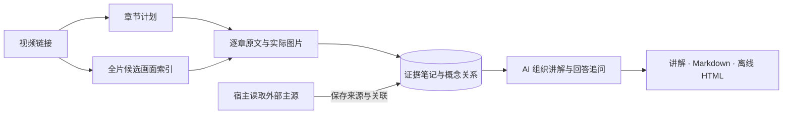

# VidLens

**让 AI 逐章阅读视频，再把技术过程讲清楚。**

VidLens 为 YouTube 和哔哩哔哩视频提供字幕、章节、实际画面与可追溯笔记。AI 可以沿着一节课的讲解顺序通读，核对代码和图表，把前后的概念接起来，再回答追问、补充资料或制作学习材料。

[](https://www.youtube.com/watch?v=aircAruvnKk)

材料和笔记保存在本机，后续追问可以复用。理解与讲解由当前会话中的 AI 完成，VidLens 本身无需另配 LLM API key。服务通过标准 **stdio MCP** 接入，也提供独立 CLI。

## 快速开始

准备 Python 3 和 [uv](https://docs.astral.sh/uv/getting-started/installation/)，在仓库根目录运行：

```sh
python3 scripts/bootstrap.py
```

脚本按锁文件准备 Python 3.12 环境，并生成 `integrations/ai/mcp.json` 和 `integrations/ai/codex.toml`。将适合客户端的服务配置合并到其 MCP 设置后重连。默认只生成本地文件；需要跳过本地语音转写依赖时，加 `--captions-only`。

Apple Silicon 上可用 `python3 scripts/bootstrap.py --apple-asr` 安装可选的 MLX 转写后端。阅读计划会向 AI 提供本机可用配置；首次使用 large-v3-turbo 需要下载约 1.6GB 权重。中文技术词的真实对照与模型取舍见 [质量实验](docs/reviews/2026-11-06-quality.md)。

| 使用方式 | 接入选择 |
|---|---|
| 普通 MCP 客户端 | 使用生成的配置；查看视频画面需要客户端支持 MCP 图片内容。 |
| 支持 skill 的 AI 客户端 | 加载 [read-video skill](skills/read-video/SKILL.md)，获得逐章阅读、笔记和技术讲解的工作流。 |
| 当前 Codex 项目 | 显式运行下方命令，安装项目 skill 并合并项目 MCP 配置。 |
| 终端或没有 MCP 的环境 | 使用 CLI；图片结果需要通过图片工具打开。 |

```sh
.venv/bin/python scripts/install-ai.py --project-skill --project-mcp
```

安装脚本保留已有配置，不修改全局设置。其他客户端的配置格式、缓存路径和排查步骤见 [AI 接入说明](docs/ai-setup.md)。当前启动脚本使用 macOS／Linux／WSL 的 `.venv/bin/python` 路径。

## 可以怎样使用

给连接了 VidLens 的 AI 一个链接和任务，例如：

> 逐章读完这个视频，讲清作者从什么问题出发、方法如何工作、实验验证了什么。核对相关公式和代码，并附时间定位。

> 回到刚才 attention 的推导，带我用一个小输入算一遍。需要补充前置知识时，查阅原始论文或官方文档，并保留来源。

> 把这个处理流程做成可以逐步切换的离线讲解，展示每一步的输入、变化和结果。

全片阅读从 `read_video(intent="summary")` 开始。首个响应提供章节计划，AI 接着读完每章的分页原文、检查相关图片并保存笔记。具体问题使用 `intent="question"`，可以直接定位原文，再展开前后语境。

CLI 使用同一个服务入口：

```sh
export VIDLENS_HOME="$PWD/.vidlens"

# 取得全片阅读计划
.venv/bin/vidlens inspect 'https://www.youtube.com/watch?v=aircAruvnKk' \
  --intent summary

# 回答一个具体问题所需的原文
.venv/bin/vidlens inspect 'https://www.youtube.com/watch?v=aircAruvnKk' \
  --intent question --question '为什么演示采用两个隐藏层、每层 16 个神经元？'
```

接着使用返回的 `video_id` 和章节 ID 执行 `section`。`scan` 查看全片候选画面，`frames` 和 `crop` 核对局部细节；`note` 保存证据笔记，`knowledge` 检索已有知识，`export` 导出 Markdown。具体命令与分页方式见 [阅读流程](skills/read-video/references/workflow.md)。B站多分 P 链接保留 `?p=N`。

## 从视频到学习材料



- **先建立阅读地图。** 结合平台章节、句子边界、停顿和词汇变化生成候选章节，保留完整时间范围。AI 读过材料后可以调整章节和标题。
- **按问题找画面。** 原文、屏幕文字与相邻变化共同定位候选；手写公式、树图和箭头关系可先看带编号的预览，再取回关键步骤的原图。小字阅读同时返回上下文和源像素 PNG 局部块，也可尝试升级媒体画质，并标明实际尺寸。
- **核对数字再讲结论。** 图表字段按位置关联数字和单位，原图以无损裁剪交给 AI 复核；讲解前再检查指标含义、单位换算和整篇新增的量化断言。[核对流程](skills/read-video/references/fact-checking.md)保留可追溯依据，效果见[真实视频对照](docs/reviews/2026-11-06-figure-facts.md)。
- **把理解留在证据旁边。** 章节笔记记录概念、结论和因果关系，每条事实引用原始字幕或画面 ID。追问可以沿已有关系找回跨章节的中间步骤。外部资料由宿主 AI 搜索、阅读，再保存来源及其与章节的联系。
- **用原图讲清过程。** Markdown 导出保留事实、关系与引用过的画面；skill 附带的 [交互讲解工具](skills/read-video/references/interactive.md) 可生成单文件离线 HTML，把原图、解释和状态变化放在同一步中，逐步查看。

## 可用边界

平台访问、字幕和媒体获取取决于链接权限与当前网络环境。缺少字幕时可以使用可选的本地 Whisper；首次转写需要准备模型，全片视觉扫描也需要取得媒体。缓存读取、首次下载、扫描、OCR 和 ASR 是不同的工作阶段。

低清扫描给出值得查看的时间点。实际图片仍需由 AI 检查，细微文字变化可能需要补帧和裁剪。阅读进度分别记录文字交付、画面采样与笔记，不能仅凭进度数字判断解释是否正确。纯文本客户端可以读取字幕，屏幕内容的核对需要图片能力。

本轮取帧、缓存、检索和讲解的修复清单见 [深度复核报告](docs/reviews/2026-11-06.md)。历史开发基线、测量条件与复现方法保留在 [验证记录](docs/validation.md)。其中的本地文本 token 估计用于比较工具响应，不代表 AI 客户端的实际账单。

问题选图与最终讲解的真实对照见 [视觉复核报告](docs/reviews/2026-11-06-question-visual.md)：它同时记录补齐的步骤、没有提升的案例、原稿错误，以及预览额外消耗的图片上下文。

小字阅读另用 MySQL、Wireshark、分类模型三条中文视频验证，逐项检查源值、单位和读者复现。[低清图表复核](docs/reviews/2026-11-06-small-text.md)保留了新流程读错数量级的样本：原尺寸分块改善取证，最终准确性还需要独立读数与全文核对。

## 开发

```sh
.venv/bin/python -m pytest
.venv/bin/ruff check src tests scripts benchmarks skills/read-video/scripts
```

测试默认离线。模块与数据生命周期见 [架构说明](docs/architecture.md)，阅读策略和讲解资源位于 [skills/read-video](skills/read-video)，可复现评测位于 [benchmarks](benchmarks)。私有运行材料保存在 `.vidlens`，不进入版本库。
