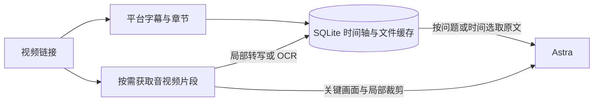

# VidLens

VidLens 帮助 Astra 阅读 YouTube 和哔哩哔哩上的技术课程、编程教程与论文讲解。给它一个链接和问题，Astra 就能取得相关原话及时间定位。如果答案取决于屏幕上的公式、代码或实验数据，它还可以回到对应片段查看画面。

[](https://www.youtube.com/watch?v=aircAruvnKk)

平台字幕、OCR 和局部视频保存在本机，追问时可复用这些材料。VidLens 将证据交给当前会话中的 Astra 分析，无需另外配置 LLM API key。

## 快速开始

先准备 Python 3 和 uv，再在仓库根目录运行以下命令。脚本按锁文件安装 Python 3.12 运行环境，并配置本项目的 MCP 服务与阅读 skill。以下示例已在 Apple Silicon macOS 验证。[uv 安装说明](https://docs.astral.sh/uv/getting-started/installation/)

```sh
python3 scripts/bootstrap.py --activate
```

在 Codex 中打开或信任当前项目，新建使用 Astra 的对话，发送视频链接和你关心的问题即可。若只需字幕和画面，可以在安装命令后加 `--captions-only`，跳过本地语音转写运行库。接入配置、重连和诊断命令见 [Astra 接入说明](docs/astra-setup.md)。

也可以在终端体验同一个入口。下面的课程和问题来自仓库内的实测样例。

```sh
export VIDLENS_HOME="$PWD/.vidlens"

.venv/bin/vidlens inspect 'https://www.youtube.com/watch?v=aircAruvnKk' \
  --question '为什么演示采用两个隐藏层、每层 16 个神经元？' --max-tokens 2500

.venv/bin/vidlens read 'youtube:aircAruvnKk' 04:13 04:33
.venv/bin/vidlens frames 'youtube:aircAruvnKk' 11:34 11:42 --max-frames 2
```

首条命令返回带 `start`、`end`、`text` 和 `source` 的证据。后两条演示用 `video_id` 展开字幕和查看画面。CLI 返回图片路径，MCP 直接返回图片。B站链接同样适用，多分 P 视频保留 `?p=N`。

## 阅读流程



| 遇到的问题 | Astra 如何读取 |
|---|---|
| 讲者为什么得出这个结论？ | `read_video` 按问题选取有时间戳的原始片段。前提或限定出现在片段边界时，再用 `read_interval` 展开。 |
| 代码到底改了哪行？图中的基线是什么？ | `read_frames` 获取局部画面及 OCR。小字可用 `crop_frame` 放大。画面中的数字和公式可以直接核对。 |
| 没有字幕怎么读？ | `transcribe_video` 对指定区间运行本地 Whisper。首次使用需要下载权重，结果会保留转写来源和实际处理区间。 |
| 这份解释覆盖了视频的哪些部分？ | `video_coverage` 列出已经交付的文字区间和画面时间点。完整字幕、采样字幕、局部转写和问题检索结果各有模式标记。 |

默认 MCP 暴露表中的 6 个工具。CLI 还可导入本地字幕与视频、查看环境和检索缓存。字幕检索采用本地 BM25、简繁归一和技术术语别名。OCR 的可用后端由本机环境决定，macOS 可用 Vision，其他环境可选 Tesseract。

## 实测

仓库附带的基线评测使用一节 18 分 40 秒的 3Blue1Brown 课程。5 道开发问题覆盖 4 个主题，其中一道需要联合开头、中段和结尾的证据。每次统计完整工具响应 JSON，并与同一视频的全文纯字幕比较。

| 指标 | 结果 |
|---|---:|
| 全文字幕 | 4,842 个估计文本 token |
| 单次问题响应 | 平均 1,740 个估计文本 token，开发基线为 2,185 |
| 标注的必要证据窗口 | 10 / 10 命中 |
| 已缓存素材的检索 p50 | 同实例约 2.35 ms，新进程约 192 ms（2,500 token 预算） |

计量范围限于返回文本，使用 `o200k_base` 估算。首次视频获取、解码、转写、图像输入及 Astra 的推理有各自的耗时与成本。这组开发题衡量证据定位，跨视频泛化和最终答案质量仍需更多样例验证。[前后对照与测量条件](docs/validation.md) · [原始评测结果](benchmarks/results/reading.json)

## 开发

```sh
.venv/bin/python -m pytest
.venv/bin/ruff check src tests scripts benchmarks
```

模块职责与缓存策略见 [架构说明](docs/architecture.md)，Astra 阅读策略位于 [skills/read-video](skills/read-video)，评测问题、运行器和结果位于 [benchmarks](benchmarks)。测试默认离线，真实平台测试的素材与 tokenizer 缓存准备步骤见 [验证记录](docs/validation.md)。
