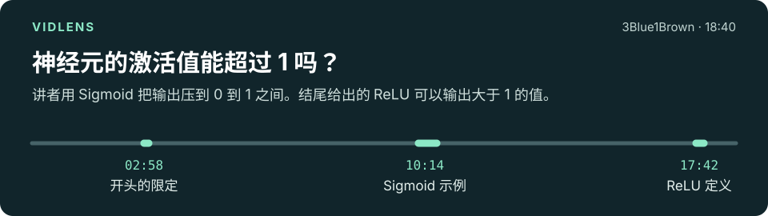
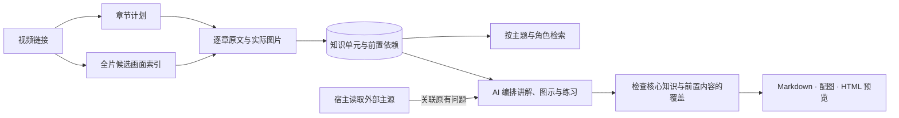

# VidLens

**把视频里的知识组织起来，讲清每一步为什么这样做。**

VidLens 为 YouTube 和哔哩哔哩视频提供原文、实际画面与可追溯的知识单元。AI 先通读材料，把概念、过程、推导和实验连接起来，再按学习目标组织讲解。结果可以保存成带配图的 Markdown，或用于后续追问。

[](https://www.youtube.com/watch?v=aircAruvnKk)

材料和笔记保存在本机，后续追问可以复用。理解与讲解由当前会话中的 AI 完成，VidLens 本身无需另配 LLM API key。服务通过标准 **stdio MCP** 接入，也提供独立 CLI。

**看看实际成稿：** [YOLOv1 完整图文讲解](examples/yolov1/README.md)把一段 39 分钟的视频整理为 10 节，包含坐标演算、训练分工、NMS、原始实验图与可运行的复算代码。[本轮验证](docs/reviews/2026-11-06-article-workflow.md)记录来源复核、独立读者任务和协议开销。

## 快速开始

准备 Python 3 和 [uv](https://docs.astral.sh/uv/getting-started/installation/)，在仓库根目录运行：

```sh
python3 scripts/bootstrap.py
```

脚本按锁文件准备 Python 3.12 环境，并生成 `integrations/ai/mcp.json` 和 `integrations/ai/codex.toml`。将适合客户端的服务配置合并到其 MCP 设置后重连。默认只生成本地文件；需要跳过本地语音转写依赖时，加 `--captions-only`。

Apple Silicon 上可用 `python3 scripts/bootstrap.py --apple-asr` 安装可选的 MLX 转写后端。阅读计划会向 AI 提供本机可用配置；首次使用 large-v3-turbo 需要下载约 1.6GB 权重。中文技术词的真实对照与模型取舍见 [质量实验](docs/reviews/2026-11-06-quality.md)。

| 使用方式 | 接入选择 |
|---|---|
| 普通 MCP 客户端 | 使用生成的配置；查看视频画面需要客户端支持 MCP 图片内容。 |
| 支持 skill 的 AI 客户端 | 加载 [read-video skill](skills/read-video/SKILL.md)，获得逐章阅读、笔记和技术讲解的工作流。 |
| 当前 Codex 项目 | 显式运行下方命令，安装项目 skill 并合并项目 MCP 配置。 |
| 终端或没有 MCP 的环境 | 使用 CLI；图片结果需要通过图片工具打开。 |

```sh
.venv/bin/python scripts/install-ai.py --project-skill --project-mcp
```

安装脚本保留已有配置，不修改全局设置。其他客户端的配置格式、缓存路径和排查步骤见 [AI 接入说明](docs/ai-setup.md)。当前启动脚本使用 macOS／Linux／WSL 的 `.venv/bin/python` 路径。

## 可以怎样使用

给连接了 VidLens 的 AI 一个链接和任务，例如：

> 逐章读完这个视频，讲清作者从什么问题出发、方法如何工作、实验验证了什么。核对相关公式和代码，并附时间定位。

> 回到刚才 attention 的推导，带我用一个小输入算一遍。需要补充前置知识时，查阅原始论文或官方文档，并保留来源。

> 把这个处理流程做成可以逐步切换的离线讲解，展示每一步的输入、变化和结果。

全片阅读从 `read_video(intent="summary")` 开始。首个响应提供章节计划，AI 接着读完每章的分页原文、检查相关图片，再整理知识与文章计划。没有可用文字或本地转写尚未覆盖全片时，可加 `prepare=True` 准备转写，取得完成后的当前章节版本。具体问题使用 `intent="question"`，可以直接定位原文，并在预算允许时带回已有知识单元及前置内容。

CLI 使用同一个服务入口：

```sh
export VIDLENS_HOME="$PWD/.vidlens"

# 取得全片阅读计划
.venv/bin/vidlens inspect 'https://www.youtube.com/watch?v=aircAruvnKk' \
  --intent summary

# 回答一个具体问题所需的原文
.venv/bin/vidlens inspect 'https://www.youtube.com/watch?v=aircAruvnKk' \
  --intent question --question '为什么演示采用两个隐藏层、每层 16 个神经元？'
```

接着使用返回的 `video_id` 和章节 ID 执行 `section`。`section` 和 `read` 默认按段落传递原文，共享来源信息，保留每条原始证据引用；`--representation verbose` 可查看逐句格式。`scan` 查看候选画面，`frames`、`crop`、`detail` 核对细节。B站多分 P 链接保留 `?p=N`。

阅读后的知识与成稿也由项目管理：

```sh
# 保存 AI 读过证据后整理的知识单元，再按主题或角色检索
.venv/bin/vidlens save-units VIDEO_ID --revision REVISION --file units.json
.venv/bin/vidlens units VIDEO_ID --query '预测框怎样参与训练' --role mechanism

# 保存文章计划，检查正文覆盖，再导出可携带的图文讲解
.venv/bin/vidlens article-plan VIDEO_ID --revision REVISION --file plan.json
.venv/bin/vidlens audit-article VIDEO_ID --revision REVISION --file draft.json
.venv/bin/vidlens article VIDEO_ID --revision REVISION --file draft.json --output lesson
```

导出目录包含 `README.md`、`assets/`、`preview.html` 和 `manifest.json`。图片使用相对路径，目录可以跳转到对应章节；来源截图、AI 编写的 SVG 示意和可选教学代码／数据附件都随文章保存。JSON 格式见 [文章工作流](skills/read-video/references/articles.md)，原文与图片命令见 [阅读流程](skills/read-video/references/workflow.md)；旧的 `note`、`knowledge`、`export` 仍用于章节笔记。

## 从视频到学习材料



- **先建立阅读地图。** 结合平台章节、讲解转折、停顿和词汇变化生成候选章节，无标点的连续转写也参与话题判断。保留完整时间范围；已有笔记或人工修订的章节不会因分章算法升级而被自动重切。
- **按问题找画面。** 原文、屏幕文字与相邻变化共同定位候选；手写公式、树图和箭头关系可先看带编号的预览，再取回关键步骤的原图。小字阅读同时返回上下文和源像素 PNG 局部块，也可尝试升级媒体画质，并标明实际尺寸。
- **核对数字再讲结论。** 图表字段按位置关联数字和单位，原图以无损裁剪交给 AI 复核；讲解前再检查指标含义、单位换算和整篇新增的量化断言。[核对流程](skills/read-video/references/fact-checking.md)保留可追溯依据，效果见[真实视频对照](docs/reviews/2026-11-06-figure-facts.md)。
- **按知识组织材料。** 知识单元可以引用不同章节的原文与画面，记录多种角色、概念关系和前置单元。检索命中后连同必要前置内容一起返回；预算放不下时不悄悄截断依赖。分类与解释由 AI 在阅读后写入，程序校验来源和结构。
- **从读完走向讲完整。** 文章计划把知识单元映射到正文、图示目的和练习。成稿检查核对核心单元、前置依赖，以及计划中的图片和练习是否落在对应章节；通过表示可以进入人工或 AI 审阅，不代表事实、推导和教学效果已经通过验证。
- **交付可继续阅读的文章。** 原图保留证据，自绘示意解释对象与变化；Markdown 和配图一起导出。需要逐步演示时，另可使用 [交互讲解工具](skills/read-video/references/interactive.md) 生成离线交互 HTML。

## 可用边界

平台访问、字幕和媒体获取取决于链接权限与当前网络环境。缺少字幕时可以使用可选的本地 Whisper；首次转写需要准备模型，全片视觉扫描也需要取得媒体。缓存读取、首次下载、扫描、OCR 和 ASR 是不同的工作阶段。

低清扫描给出值得查看的时间点。实际图片仍需由 AI 检查，细微文字变化可能需要补帧和裁剪。阅读进度分别记录文字交付、画面采样与笔记，不能仅凭进度数字判断解释是否正确。纯文本客户端可以读取字幕，屏幕内容的核对需要图片能力。

本轮取帧、缓存、检索和讲解的修复清单见 [深度复核报告](docs/reviews/2026-11-06.md)。历史开发基线、测量条件与复现方法保留在 [验证记录](docs/validation.md)。其中的本地文本 token 估计用于比较工具响应，不代表 AI 客户端的实际账单。

`vidlens metrics` 可以查看本地操作耗时、文本估算和返回画面的数量与尺寸。嵌套调用的耗时可能重叠，不能相加当成完整任务耗时；模型推理、图片 tokens 和客户端历史由宿主另行计量。

问题选图与最终讲解的真实对照见 [视觉复核报告](docs/reviews/2026-11-06-question-visual.md)：它同时记录补齐的步骤、没有提升的案例、原稿错误，以及预览额外消耗的图片上下文。

小字阅读另用 MySQL、Wireshark、分类模型三条中文视频验证，逐项检查源值、单位和读者复现。[低清图表复核](docs/reviews/2026-11-06-small-text.md)保留了新流程读错数量级的样本：原尺寸分块改善取证，最终准确性还需要独立读数与全文核对。

## 开发

```sh
.venv/bin/python -m pytest
.venv/bin/ruff check src tests scripts benchmarks skills/read-video/scripts
```

测试默认离线。模块与数据生命周期见 [架构说明](docs/architecture.md)，阅读策略和讲解资源位于 [skills/read-video](skills/read-video)，可复现评测位于 [benchmarks](benchmarks)。私有运行材料保存在 `.vidlens`，不进入版本库。
