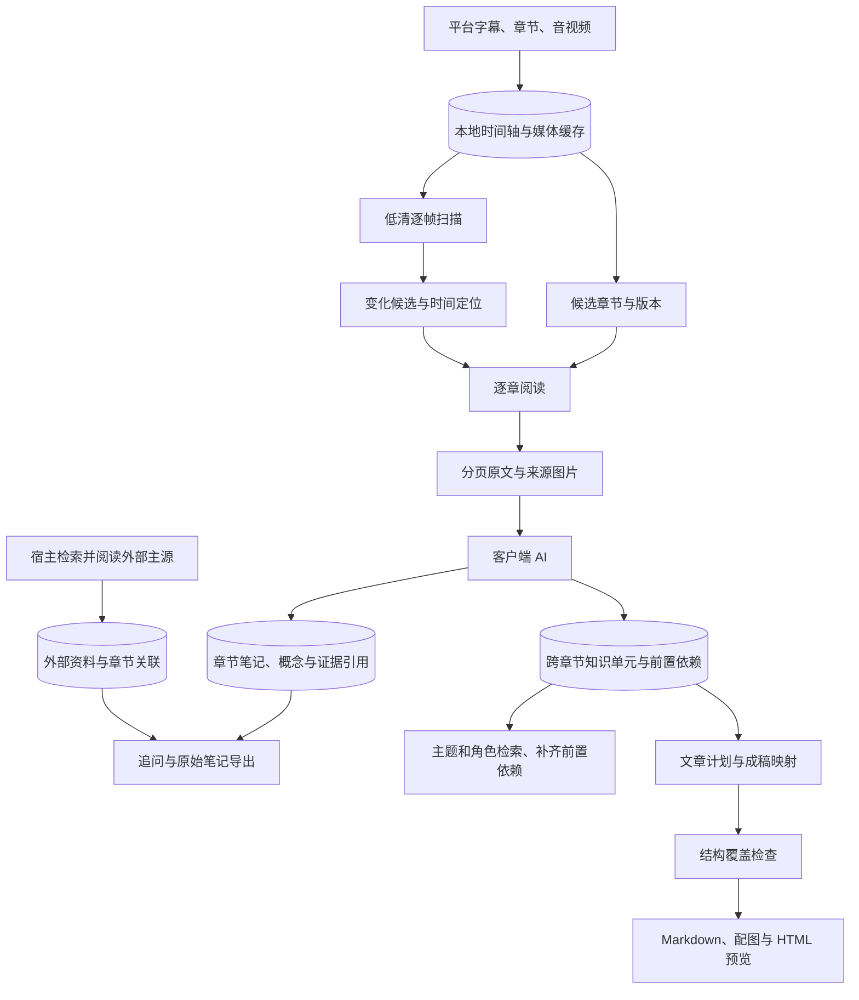

# 视频如何成为可持续阅读的材料

MCP 和 CLI 共用 [VideoService](../src/vidlens/service.py)。服务负责取得原始材料、组织阅读顺序、传递图片和保存笔记；当前客户端中的 AI 负责理解、讲解与外部资料研究。阅读策略位于 [read-video skill](../skills/read-video/SKILL.md)，服务不会自行调用另一个托管大模型。

## 两种阅读入口

`read_video(url, intent="summary")` 返回 `study_plan`，包含当前 `revision`、章节范围和进度。章节列表可以通过 `study_status` 继续分页。这个响应建立阅读任务；原文和实际图片从后续 `read_section` 获取。显式 `prepare=True` 时，若当前没有可用语音文字，或仅有未覆盖全片的本地 ASR，服务使用本机建议的后端准备全片转写，再返回新的章节版本。已有平台或导入字幕不因时间戳间隙而被判为缺失；真实缺项需结合材料按区间补读。

`read_video(url, question=..., intent="question")` 返回与具体问题相关的原始段落。检索使用本地 BM25、简繁归一和技术术语别名；引用保留原始文字。限定名同时按整体与组成部分检索，例如 `model.summary()` 可以通过 `summary` 找到。若答案依赖段落前后的条件，用 `read_interval` 展开；依赖公式、图表或代码时，取相应画面。`intent="auto"` 将空问题和常见总结请求导向全片流程，识别意图时跳过代码标识符，避免把函数名中的 `summary` 当成总结请求。

问题入口在预算允许时优先查询已保存的知识单元，把匹配项及其前置依赖与原文一起返回；没有匹配或预算不足时继续使用章节笔记和原始证据路径。知识单元不会取代原文引用。

## 全片阅读的数据流

### 1. 建立章节计划

[StudyEngine](../src/vidlens/study.py) 结合平台章节、句子结束、停顿、局部词汇变化和讲解转折生成候选范围，保留整条时间轴。无标点且没有明显停顿的 ASR 也会计算话题变化；“接下来”等转折还需有上下文变化支持，时长、字数和剩余内容约束避免把每个操作切成一章。候选标题与边界是导航信息；AI 阅读后可用 `revise_sections` 重组章节，或通过章节笔记给出更贴切的标题。

章节计划与源材料都有版本。字幕、时长或平台章节变化会影响源版本；仅添加 OCR 和画面不改变语音材料的版本。重新划分范围会产生新的章节身份，保持相同范围的改名可以保留已有笔记。保存笔记时必须携带当前 `revision`，以免将旧材料的解释写入新计划。

分章算法升级时，未注释的自动计划可重新生成；同源已有笔记或 AI 修订的布局保留原来的范围、ID 和 revision。`layout_policy` 记录 `automatic`、`authored` 或 `preserved_on_upgrade`。这项保留策略保护已完成的阅读工作；需要采用新边界时显式修订，原始材料本身改变仍会触发来源版本更新。

### 2. 建立全片视觉索引

`scan_video` 取得覆盖全片的低清媒体，并由 [StoryboardScanner](../src/vidlens/storyboard.py) 扫描解码帧。场景切换、细微帧差、时间锚点和实际末帧形成按时间排序的候选。扫描结果包含状态、解码范围、候选原因和分页游标；分页限制的是返回条数，扫描本身面向完整时间范围。

扫描使用 FFmpeg `signalstats` 的 Y/U/V 三通道帧差，既捕捉亮度变化，也捕捉仅颜色变化；相邻小变化保留首尾。服务缓存和扫描文件都绑定算法版本，更新检测规则后重新计算候选。扫描结果保留实际解码帧数、耗时和 metadata 大小，便于区分下载与解码成本。

索引保留时间点，供后续高清阅读使用。低清帧差不判断图里讲了什么，也不能保证发现每处小字改动。扫描过程的 `complete` 表示该媒体范围的处理完成；部分失败和未完成的扫描会保留相应状态。

MCP 与 CLI 的默认扫描响应保留导航所需信息，详细扫描规则、探测指标等通过 `diagnostics=True`／`--diagnostics` 展开。精简响应不改变扫描算法或候选集合。

[VisualSelector](../src/vidlens/selection.py) 在原始索引之上建立独立版本的精简导航：先取稳定保持段、局部变化峰值和短事件探针，再比较低清图的局部块差异、细节与空白状态。每条导航项保留原始候选游标；原始列表不被删改。`scan_video(view="navigation")` 返回精简地图，`view="full"` 返回全集。选择器失败或超过探针上限时明确返回完整视图；后续游标按响应中的视图继续。

局部像素差异有助于保留细小代码改动，全局均差容易把不同公式合并。像素细节密度仍不等于讲解相关性：本轮独立实验没有证实用它替换首批四图会改善最终答案，因此默认首批图片继续按时间与稳定性覆盖章节。像素优先级代表图保留在评测脚本中作实验，导航用于后续展开。

### 3. 分别推进文字和画面阅读

`read_section(video_id, section_id)` 返回本章原始语音文本、证据 ID 和实际图片。文字分页使用 `next_cursor`，按原始顺序读到末尾。仅继续文字时可设置 `include_frames=False`，避免重复传图。

MCP 和 CLI 默认使用 `representation="compact"`，由 [evidence_format](../src/vidlens/evidence_format.py) 把相邻、同来源的短句合成阅读段落，共享来源轨道和视频链接。正文中的原始字符不被改写；每段 `refs` 保留原始证据 ID、字符偏移与长度，能够恢复本页实际交付的语句范围并用于保存笔记。段落只是传输组织，不声明语义章节。需要逐句字段时使用 `representation="verbose"`；底层 Python 接口保留兼容默认值。两种表示都遵守完整响应的预算与分页游标，省略重复字段不等于截去原文。

默认图片覆盖章节中的代表性时间点。需要细读视觉变化时，设置 `frame_cursor=0`，再使用 `visual.next_frame_cursor` 继续候选序列；它与文字游标独立。每次最多返回 12 帧，默认 4 帧。`read_frames` 可直接读取特定区间，`crop_frame` 返回缓存原帧的局部。

小字和密集图表使用 `read_detail(video_id, timestamp, boxes=...)`。它将上下文原图与局部 PNG 一起交付：表头、坐标轴和实验标识留在上下文里，局部按缓存源像素分块，单块最多 1920×1080，连续块至少重叠 64 像素；预算不够覆盖指定区域时明确要求缩小区域，不截掉末尾。每块带实际 `crop_box`、区域编号与摘要。最多六个区域、十二块图片；裁块不累计为完整画面的阅读进度。MCP 的 `transmitted_size` 和 `transmitted_mime_type` 给出实际交付尺寸与格式，上下文缩略图与源像素局部块分别记录。

`upgrade_source=True` 会尝试取得更高画质，在同一时刻直接解码 PNG；默认复用缓存。返回值同时给出请求档位、解码尺寸、缓存尺寸、缩放比例和获取状态。保留源像素的上限为 3840×2160，超出上限的缩小也会记录。平台只提供 480p 时，请求 2160p 仍然只有 480p 信息；确定性显示放大可以帮助观察，但不会恢复不存在的字形。

升级时核对宽高比和两个方向的像素数，避免用像素面积更大却改变几何的画面套用旧裁剪。缓存以统一来源指纹区分视频版本；普通读取保留同一来源下可用的高质量帧，同尺寸优先 PNG，并保留已确认的显示区间与相容 OCR。旧源损坏时可以用成功的新解码恢复。

具体问题有两层选图路径。`read_frames(question=..., visual_queries=...)` 在完整变化序列上混合时间覆盖、语音命中邻域和短事件探针，读取局部 OCR 后再补查相邻状态。首轮最多 48 帧，补查最多 48 帧；原图与 OCR 缓存复用。纯函数 [QueryVisualSelector](../src/vidlens/visual_relevance.py) 按屏幕词语、多目标增量匹配和状态差异选择，明确区分语音命中与屏幕命中，并降低常驻标题的权重。只合并相邻完全相同图片，保留 A→B→A 的返回状态。

OCR 无法表达树节点的连线、手写推导的框选关系。[QuestionFrames](../src/vidlens/visual_query.py) 因而支持 `preview=True`：在问题相关候选之外保留时间覆盖，交给 [visual_preview](../src/vidlens/visual_preview.py) 生成最多 24 个候选、每页 6 格的带编号预览。宿主 AI 实际查看后，用候选的 `read_timestamp` 调用 `read_frames(timestamps=[...])` 取回原图；缺少关键转折时可缩小区间再预览。服务不调用额外托管模型，这一步的语义判断由原有 AI 完成，并额外消耗图片上下文。

探针只用于定位，不计入原图交付。预览图片单独计数，最终成功编码的原图才登记画面交付；语音与媒体版本变化会终止失效的选图。局部扫描游标带 `scan_id`、范围和作用域，与整片游标区分。OCR 无可用文字时返回时间覆盖；预览仍可让 AI 直接看图。末帧保持扫描器实际 PTS，避免平台四舍五入的时长将取图推进到视频结尾之后。

MCP 将图像作为内容块传输，并用 `image_index` 对应到时间点；相同图片可以共用一个图像索引。CLI 返回本地图片路径，调用方需要实际打开它们。OCR 是辅助文本，检查公式符号、坐标轴和代码时仍需查看像素。

图表核对使用 `check_facts(video_id, claims)`。每个关键数值带上字段名、单位、统计范围、解释和已缓存帧时间，可指定包含表头的局部区域。[fact_check](../src/vidlens/fact_check.py) 按 OCR 的纵向位置关联同一行的字段与数值，分别返回数值和单位的匹配结果；跨行数值、重复标签和多数值列不会静默合并。`exact_literal` 只表示字符匹配，指标含义、实验归属和推导仍由实际看图的 AI 核对。

Vision 的逐行区域与 Tesseract 的逐词区域统一为左上角归一化 `box`，保留文字与识别置信度。布局缓存版本为 3，OCR 优先使用保留的源图，并按源文件身份使旧结果失效；普通原图响应保留简洁 OCR 字符串，裁剪与核对才展开所需位置。裁剪缓存及 MCP 内容均使用 PNG，`crop_box` 记录像素取整后的源图区域；不同裁剪不会因原帧时间相同而共用错误的图片索引。核对结果携带来源版本、图像摘要及原视频链接，编码后重新验证来源版本，裁剪不计作完整原帧交付。

定点取帧按相邻的真实 PTS 找到请求时刻正在显示的画面。`timestamp` 保留原帧时间，`requested_timestamp` 记录请求，`visible_until` 记录画面持续到何时；低帧率和可变帧率视频也遵守这一规则。候选解码或 MCP 图片编码失败时，下一游标指向首个未交付候选，成功编码的图片才计入阅读进度。替换本地视频后，旧帧、旧裁剪和旧视觉阅读状态会失效。

### 4. 保存理解与来源

`save_note` 保存 AI 写出的章节标题、解释、概念、章节作用、事实和关系。事实及关系引用返回的原始证据 ID；画面使用帧证据 ID。服务校验引用所属范围和版本，文字交付、画面采样、笔记保存分别记录进度。这些状态帮助发现未读材料，不能替 AI 证明理解已经正确。

需要前置知识或延伸材料时，宿主 AI 使用自己的 web 工具检索并阅读原始论文、官方文档等，再调用 `add_reference` 保存 URL、标题、短摘录、解释和相关概念。[ReferenceStore](../src/vidlens/references.py) 将这些材料标为外部来源，保持其与视频讲者陈述的区别；保存操作本身不会抓取该网页。

`search_knowledge` 在已保存的章节笔记、概念关系和外部来源中检索。除了关键词命中，它沿已有关系寻找最多三跳的连接路径。例如“量化如何影响吞吐量”可以带回“显存占用→批大小”这一中间步骤。路径发现可双向遍历，返回时保留作者写下的方向和证据引用；不自动创造因果关系。检索只索引作者内容，不把 `source`、`target` 等字段名当知识。

问答返回的 `knowledge` 是已保存笔记和外部资料的检索摘录；原始视频材料仍在 `evidence` 中。追问涉及笔记未覆盖的细节时，回到原文或画面。CLI 的 `export` 在一致快照中导出章节标题、解释、事实、关系和来源，并嵌入引用过的本地原帧。Markdown 保留本地图片路径；需要便携文件时使用下面的 HTML helper。

### 5. 把知识与时间章节分开

[Curriculum](../src/vidlens/curriculum.py) 保存 AI 阅读后形成的知识单元。每个单元包含稳定 ID、解释、角色、概念、原始证据、重要性、前置单元 `requires`，也可附例子、问题和带证据的关系。单元可引用同一视频中多个章节的语音或原帧，因此一项机制的定义、示例和局限不必被时间切片拆散。

`save_knowledge` 校验证据属于当前视频与来源版本、依赖存在且没有环，再原子保存。它不自动推断分类或认证解释；这些内容由宿主 AI 提交。来源版本未变时，单纯修订时间章节不会丢失知识单元。更新知识会改变 `knowledge_revision`，使旧文章计划显式过期。

`query_knowledge` 按关键词和术语别名匹配知识单元，可用 `roles` 筛选命中的角色。返回命中单元前，按依赖顺序补齐其完整前置闭包；前置单元可以不符合角色过滤，因为它们承担理解所需的背景。预算不足以容纳某个命中及其依赖时跳过这一整组并标记 `truncated`，不返回貌似完整的半条推导。这里仍是词项检索与显式依赖遍历，没有自动 embedding 分类或自动生成因果边。

原有章节笔记、`search_knowledge` 和外部引用继续保留；它们与知识单元服务于不同用途。章节笔记记录阅读范围，知识单元组织可复用的解释对象。具体问答可先查询知识单元，再按证据回读原文和图片；完整总结则需要核对全片的核心单元覆盖。

### 6. 形成可交付讲解

`article_plan` 保存面向读者的文章计划：目标、正文段落、关联知识单元、每张图要解释什么、练习所涉及的知识，以及有理由省略的辅助内容。它绑定当前知识版本，与时间章节可以采用不同的顺序。

`audit_article` 检查草稿中 `<!-- section:ID -->` 标记下的实际摘录是否与声明的知识映射相符，检查核心单元及其前置依赖是否覆盖，并识别过期计划。`visual_coverage` 和 `exercise_coverage` 用从 0 开始的索引对应本节计划中的图与练习：图片必须是该节正文中实际引用的资产，练习摘录必须出现在该节。代码围栏里的示例标记和图片语法不计入交付。`ready_for_review` 只表示这组结构检查通过；并不证明摘录表达正确、公式推导成立、图示准确或读者已经理解，仍需看图、事实核对与阅读审查。

[article](../src/vidlens/article.py) 将通过结构检查的草稿导出为新目录：`README.md` 使用 `assets/` 相对图片路径，`preview.html` 用于浏览器检查，`manifest.json` 记录来源版本、文件摘要和覆盖检查。来源图片通过本视频的 `frame:TIME` 证据 ID 定位，可用归一化 `box` 裁剪，导出为 PNG；自绘图使用被动 SVG 图形与文字。草稿里的 `asset:NAME` 被替换为相对路径，清单不需要本机私有缓存路径。图稿是 AI 编写的教学材料，需与源图区分。

导出器将已验证的 section 标记转换为实际 `` 锚点，使 Markdown 与 HTML 的目录链接都能跳转；Markdown 保留原标记，输入中的任意 HTML 仍被拒绝。`attachments:[{name,text}]` 可附带正文相对链接引用的教学脚本或数据，限定最多 10 个 `.py/.json/.txt/.csv` 文件，每份最多 100,000 UTF-8 字节；导出不执行附件。所有内容先在临时目录组装，再独占创建输出目录，最后写入清单作为完成标志。已有目录不会被覆盖；发布目录前再次检查知识、计划和源图像素是否变化。

CLI 的 `save-units`、`units`、`article-plan`、`audit-article`、`article` 对应这些步骤，输入 JSON 由阅读材料的 AI 编写。旧 `export` 保留为章节笔记的 Markdown 导出，不自动改写成完整文章。

文字解释由 AI 按问题与因果关系组织。适合逐步演示的流程可以整理为 JSON，再由 skill 的 [build_lesson.py](../skills/read-video/scripts/build_lesson.py) 生成单文件 HTML。页面逐步显示字幕、原视频图片、解释和状态卡片，支持按钮、选择器和键盘导航。图片先经 Pillow 解码校验、限制尺寸、去除元数据，再以内嵌资产保存；相同图片去重，不依赖原文件位置或网络。每张图保留图注与原片时间链接。

可选的 softmax 图表会随温度滑块重新计算概率，适合讲解分数如何变成权重。教学数据由 AI 明确标注，页面只运行内置的交互逻辑，不加载 CDN。写作指南鼓励沿一个具体输入解释变化，用原图指出关键位置；验证日志和覆盖率记录保留在工作记录中。

## 模块与存储边界

| 模块 | 负责的工作 |
|---|---|
| [VideoService](../src/vidlens/service.py) | 协调读取与本地写入；同一视频的内容变更使用锁。 |
| [SourceProvider](../src/vidlens/sources.py) | 解析 YouTube／B站及分 P 链接，取得字幕和媒体，提供本地 ASR 路径。 |
| [Store](../src/vidlens/store.py) | SQLite 保存视频、带时间的原文、OCR、图片记录和已交付范围。 |
| [EvidenceReader](../src/vidlens/reading.py) | 原文检索与区间分页，复用当前证据快照和倒排索引。 |
| [LearningReader](../src/vidlens/learning.py) | 连接章节计划、视觉索引、章节阅读、笔记检索和导出。 |
| [StudyEngine](../src/vidlens/study.py) | 生成和修订章节，维护源版本、阅读状态和有证据引用的笔记。 |
| [ReferenceStore](../src/vidlens/references.py) | 保存宿主读过的外部来源，并与章节笔记一起检索。 |
| [Curriculum](../src/vidlens/curriculum.py) | 跨章节知识单元、依赖检索、文章计划及结构覆盖检查。 |
| [Article export](../src/vidlens/article.py) | 打包 Markdown、来源图片与自绘 SVG、HTML 预览和摘要清单。 |
| [Evidence format](../src/vidlens/evidence_format.py) | 无损段落传输与原始证据字符范围映射。 |
| [MediaCache](../src/vidlens/media_cache.py) | 按来源版本、音视频类型和分辨率复用覆盖请求区间的媒体。 |
| [VisualReader](../src/vidlens/visual.py) 与 [StoryboardScanner](../src/vidlens/storyboard.py) | 全片视觉索引、局部选帧、高清图片、OCR 和裁剪。 |
| [VisualSelector](../src/vidlens/selection.py) | 保留全集的精简视觉导航、局部像素比较和来源游标映射。 |
| [Figure fact checks](../src/vidlens/fact_check.py) | 按几何行核对字段、数字及单位，返回需看图处理的歧义；不认证指标含义。 |
| [TokenBudget](../src/vidlens/budget.py) | 控制完整文本 JSON 的预算，保留后续可继续读取的游标。 |
| [Telemetry](../src/vidlens/telemetry.py) | 本地操作耗时、文本估算与返回图片元数据。 |

字幕、媒体、扫描索引和模型运行缓存默认位于 `.vidlens`。音轨与视频独立缓存：具体问题可以只取局部区间，全片扫描需要覆盖全片的媒体。成功取得的媒体才进入可复用目录；已覆盖请求的缓存可用于后续更小的区间。

媒体区间使用精确浮点缓存键，manifest 记录实际范围、文件大小和修改时间；旧缓存需通过范围校验后才能复用。相同整片预取的并发失败共享退避，避免多个客户端重复下载。ASR 替换在事务中清除被替换片段的交付记录；同文同时间的不同语言或来源保留各自身份，分页游标也绑定这些来源信息。

ASR 后端和模型由 [asr.py](../src/vidlens/asr.py) 解析，推理在独立 worker 中执行。CPU 路径保持 faster-whisper；Apple Silicon 的可选 [MLX worker](../src/vidlens/asr_mlx.py) 使用 large-v3-turbo、Silero 语音检测和原始时间回映射。检测不到语音时直接返回空结果，避免静音产生假字幕。模型通过固定仓库文件与提交、摘要校验后进入私有缓存。后端、模型、语言和词表共同参与转写缓存身份；成功替换跨后端清理旧 ASR，失败保留旧材料。

文字分页游标绑定原始区间和证据状态。超长单条字幕可从字符位置继续；材料改变后需要重新取得当前游标。服务的本地 token 估算用于约束工具文本，图像输入、客户端模型推理和最终回答的成本由宿主分别承担。

启用测量的服务调用将操作名、运行 ID、耗时、状态、可用的缓存命中信息、文本估算及返回图片尺寸写入 `.vidlens/metrics/operations.jsonl`；`metrics --run-id ID` 可按运行读取。日志不保存正文。嵌套或并行操作的时间不能相加作为任务总时长，这些记录也不包含模型真实账单。服务返回的图片元数据与客户端最终收到的图像数量需要按各自测量位置解释。

## 接入边界

默认 MCP 提供 19 个阅读与学习工具，包括 `save_knowledge`、`query_knowledge`、`article_plan` 和 `audit_article`。设置 `VIDLENS_ADVANCED_TOOLS=1` 后增加导航和诊断入口，共 24 个；CLI 不受该开关影响。文章目录导出通过 CLI `article` 执行。标准 stdio 客户端可以读取文字，画面核对需要支持 MCP 图片内容的客户端。安装器生成通用 MCP 与 Codex 配置片段，只有显式选项才写入项目配置和 skill。

配置、依赖与排查见 [AI 接入](ai-setup.md)。历史开发基线和测量条件见 [验证记录](validation.md)；其中的已缓存检索、下载、解码、OCR 和 ASR 耗时应按各自条件理解。
