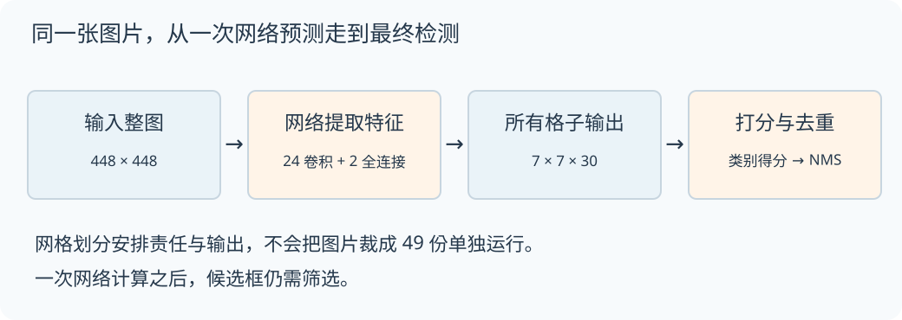
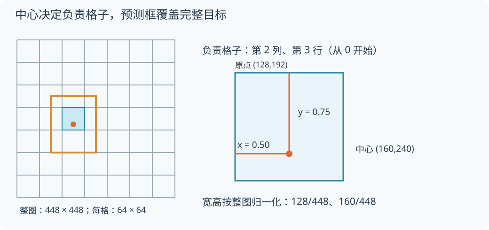
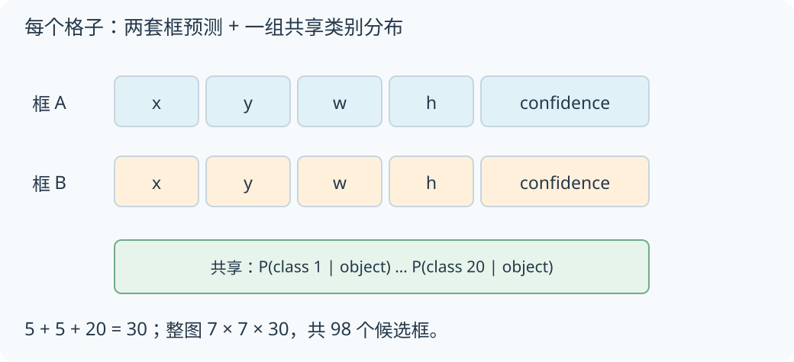
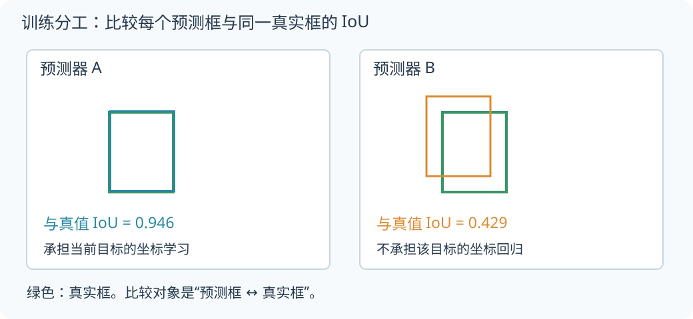
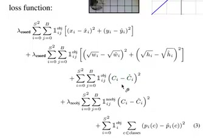
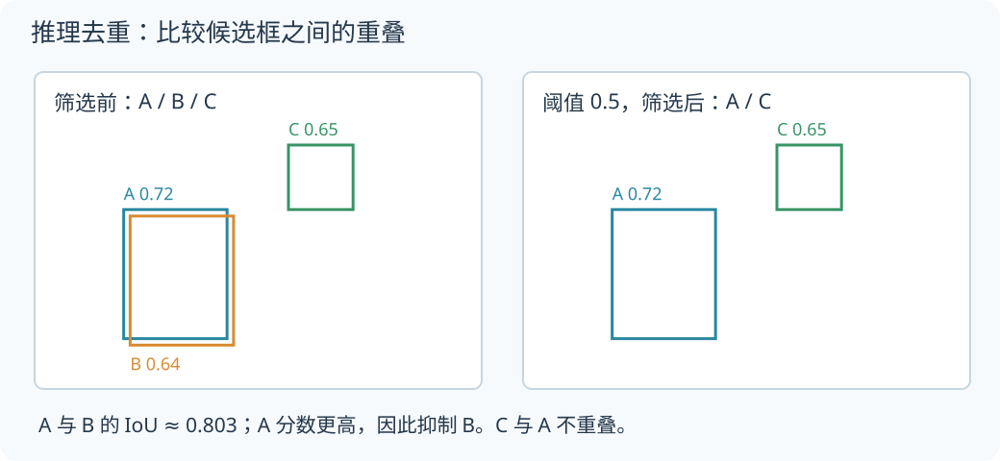
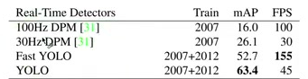
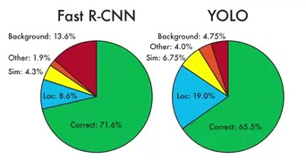

# YOLOv1 精读：一张图片，怎样变成一组检测框？

> 根据《目标检测之 YOLOv1 论文精讲》整理。原视频 **39 分 27 秒**：[打开视频](https://www.bilibili.com/video/BV1KT2yBJESn/?p=1)。
>
> 这篇讲解沿着“输入图片 → 网格分工 → 输出解码 → 训练 → 筛选 → 实验”走一遍。蓝橙示意图是依据视频重绘的教学图；文中虚构的坐标、概率和候选框都标为教学演算，方便你动手计算。

YOLOv1 把目标检测写成一个统一的预测任务：网络接收整张图片，同时输出物体的位置、框的置信度和类别信息。它的关键设计，是把输出安排进网格，再让一个损失函数共同训练这些预测。由此获得的速度优势，与它在密集小目标和精确定位上的困难，来自同一套设计。

读完后，你应该能够解码一个预测框，说明两个框预测器怎样分工，算一次类别得分和 NMS 筛选，并读懂论文中的速度、mAP 与错误分析。

**阅读路线**：[整体流程](#flow) · [网格与坐标](#grid) · [30 个输出](#output) · [网络](#network) · [训练分工](#assignment) · [损失](#loss) · [NMS](#nms) · [训练设置](#training) · [实验与局限](#experiments) · [动手核对](#practice)

<!-- section:flow -->
<a id="flow"></a>

## 1. 先让一张图片走完整个流程

假设输入图片里有一只狗和一辆自行车。分类任务只需回答图片属于什么类别；检测还要回答每个物体在哪里。因此，检测输出既需要类别，也需要包围物体的矩形框。

视频先回顾 R-CNN 系列：围绕候选区域提取特征，再进行分类与位置回归。不同版本对特征提取的组织不同，视频同时展示了裁切候选区域和从整图特征中取得区域特征的流程。YOLOv1 把位置与类别放进一个网络里一起预测，一次前向计算就得到整图的候选结果。[原片 00:08–02:06](https://www.bilibili.com/video/BV1KT2yBJESn/?p=1&t=8)



*图 1：网格负责安排输出。所有格子都在同一次网络计算中得到预测，随后才进行得分筛选与去重。*

“只看一次”指这次统一的网络预测。输出之后仍需要处理候选框：把类别概率和框置信度组合起来，筛掉低分结果，再处理同一个物体的重复预测。先记住这条完整路径，后面的公式就都有位置可放。

<!-- section:grid -->
<a id="grid"></a>

## 2. 网格决定谁负责，框可以跨越网格

YOLOv1 在视频采用的配置中，把图片划分为 **7×7 个网格**。哪个格子包含物体的中心点，哪个格子就负责检测这个物体。[原片 10:02–10:58](https://www.bilibili.com/video/BV1KT2yBJESn/?p=1&t=602)

格子承担的是分配任务。狗可能占据好几格，它的检测框也可以跨过多条网格线；责任仍按中心点确定。网络读的是整张图片，不能把“由某个格子负责”理解成它只能看到那个小方块。

下面用一组**教学坐标**把这个规则算清楚。输入为 448×448 像素，每格边长是 `448÷7=64`。设目标中心是 `(160,240)`，宽 128、高 160。列号、行号从 0 开始：

```text
所在列 c = floor(160 / 64) = 2
所在行 r = floor(240 / 64) = 3

格子左上角 = (2×64, 3×64) = (128,192)
格内中心偏移 x = (160−128)/64 = 0.50
格内中心偏移 y = (240−192)/64 = 0.75
相对整图宽度 w = 128/448 ≈ 0.2857
相对整图高度 h = 160/448 ≈ 0.3571
```



*图 2：蓝色格子包含目标中心；橙色框表示完整目标范围。右侧把负责格子放大，显示 x、y 的参考原点。此图使用上述教学坐标。*

这里有两个不同的参考尺度：**x、y 相对格子，w、h 相对整张图片**。把它们都乘以图片宽高，会把中心位置算错。[原片 14:21–15:44](https://www.bilibili.com/video/BV1KT2yBJESn/?p=1&t=861)

反向解码时，假设网格数为 S，图片宽高为 W、H：

```text
中心横坐标 cx = (c + x) / S × W
中心纵坐标 cy = (r + y) / S × H
框的像素宽 bw = w × W
框的像素高 bh = h × H
左上角 = (cx−bw/2, cy−bh/2)
右下角 = (cx+bw/2, cy+bh/2)
```

代回刚才的数据，得到左上角 `(96,160)`、右下角 `(224,320)`。我们已经把一组抽象输出还原成了图片上的矩形。

<!-- section:output -->
<a id="output"></a>

## 3. 每格 30 个数，各自做什么？

视频在 PASCAL VOC 配置下取 `S=7、B=2、C=20`：每格预测两套框信息，并给出一组 20 类的条件概率。每个框的五个值分别是 `x、y、w、h、confidence`。[原片 15:44–18:39](https://www.bilibili.com/video/BV1KT2yBJESn/?p=1&t=944)



*图 3：两个预测框各有坐标和置信度，但共享同一组类别概率。示意图表达信息组成，不规定某个代码实现里的数组排列顺序。*

因此每格有 `2×5+20=30` 个数，整图输出为 **7×7×30**，包含 **98 个候选框**。98 是候选数，最终留下多少个检测结果，要由得分和去重决定。

类别与置信度需要分开理解：

| 预测 | 回答的问题 |
|---|---|
| 条件类别概率 `P(dog｜object)` | 假设这里确实有目标，它有多可能是狗？ |
| 框置信度 `confidence` | 这个框包含目标、并且框得准确的程度如何？ |

视频给出的置信度定义是 `P(object)×IoU`。IoU 是预测框与真实框的交集面积除以并集面积，重叠越充分，值越大。训练时可以用真实框计算目标值；推理时没有真实框，使用的是网络预测出的置信度。

最终某个框的狗类别得分为：

```text
狗类别得分 = P(dog｜object) × 框置信度
```

做一个**教学演算**：同格共享的狗类别概率为 0.8，两框置信度分别为 0.9 和 0.4，那么狗类别得分分别是 **0.72 和 0.32**。两个框的类别信息相同，定位可信程度却不同，因此最终得分不同。

这也解释了一个结构限制：两套框预测器并没有各自独立的 20 类分布。若两个不同物体的中心挤在同一格里，这套输出很难同时充分表达它们。增加 B 会增加框的信息，但不会自动增加独立的类别分布。

<!-- section:network -->
<a id="network"></a>

## 4. 网络怎样生成这组输出？

视频展示的主体网络有 **24 个卷积层和 2 个全连接层**。448×448×3 的图片经过卷积和池化，得到 7×7×1024 的特征，再由全连接层产生最终检测输出。架构受 GoogLeNet 启发，但把复杂的 Inception 模块简化为交替使用的 1×1 与 3×3 卷积。[原片 05:24–08:10](https://www.bilibili.com/video/BV1KT2yBJESn/?p=1&t=324)

1×1 卷积的重要作用，是先减少通道数，让后面的 3×3 卷积处理更少的输入通道。它也会在通道之间组合信息。

用一组**教学尺寸**看参数量，忽略偏置，并保持输出空间尺寸一致：

| 方式 | 权重数量 |
|---|---:|
| 直接做 3×3，256 通道输入、256 通道输出 | `3×3×256×256 = 589,824` |
| 先 1×1 将 256 降为 64，再 3×3 升到 256 | `256×64 + 3×3×64×256 = 163,840` |

这组例子里权重数约为原来的 27.8%。它说明“先压缩通道”为什么能减少后续计算，并不把这个比例当作整网的实际加速比。

Fast YOLO 则进一步缩小网络：视频介绍它只有 9 个卷积层，并采用更少的滤波器。因此后面的实验会看到，它更快，同时也损失了一部分检测精度。[原片 08:10–08:51](https://www.bilibili.com/video/BV1KT2yBJESn/?p=1&t=490)

<!-- section:assignment -->
<a id="assignment"></a>

## 5. 训练前先分工：两个预测器，谁来学这只狗？

网格分配只回答了“哪个格子负责”。格子里还有两个框预测器，需要继续决定谁负责学习这个目标。视频采用的规则是：**选当前预测框与真实框 IoU 最大的预测器**。[原片 21:04–22:40](https://www.bilibili.com/video/BV1KT2yBJESn/?p=1&t=1264)

继续用前面的教学真实框 `(96,160,224,320)`。设 A 预测为 `(98,158,226,318)`，B 预测为 `(64,128,192,288)`。它们各自与真实框计算重叠：

```text
真实框面积 = 128×160 = 20,480
A 的交集 = 126×158 = 19,908
A 的并集 = 20,480 + 20,480 − 19,908 = 21,052
IoU(A, 真值) ≈ 0.946

B 的交集 = 96×128 = 12,288
B 的并集 = 20,480 + 20,480 − 12,288 = 28,672
IoU(B, 真值) ≈ 0.429
```



*图 4：绿色是真实框，蓝色和橙色是两套预测器的结果。当前 A 的 IoU 更高，因此由 A 承担这个目标的坐标学习。数值为教学演算。*

“负责”决定坐标损失计算在哪个预测器上，不是测试时把 B 永久删除。随着训练进行，不同预测器会逐渐擅长不同尺寸或比例的框；这个分工由当前预测与真实框的匹配形成。

负责框的置信度目标也与 IoU 有关。在这个例子里，它的目标约为 0.946，而不是因为“确实有狗”就一律设成 1。没有目标时，置信度目标为 0。这样置信度才能同时反映存在性与定位质量。[原片 12:48–14:21](https://www.bilibili.com/video/BV1KT2yBJESn/?p=1&t=768)

<!-- section:loss -->
<a id="loss"></a>

## 6. 损失函数：哪些错要改，改多少？

视频的损失公式看起来很长，因为它同时处理几件事：中心位置、宽高、框置信度和类别。先分清这些任务，再看求和符号就容易得多。[原片 22:48–27:10](https://www.bilibili.com/video/BV1KT2yBJESn/?p=1&t=1368)

| 损失部分 | 什么时候计算 | 希望模型学会什么 |
|---|---|---|
| 中心位置 x、y | 对该目标负责的预测器 | 把框的中心移到正确位置 |
| 宽高 w、h | 对该目标负责的预测器 | 让框的尺寸匹配目标 |
| 有目标置信度 | 负责预测目标的框 | 让分数反映定位质量 |
| 无目标置信度 | 没有目标的预测 | 把背景分数压低 |
| 类别 | 包含目标的格子 | 预测正确类别 |

公式中的指示变量就是这些开关。例如负责标记为 1 时，才计算对应的坐标项；为 0 时，这一项不会把预测器拉向该目标。类别概率由同一格共享，因此类别损失按格子处理。

写训练代码时，要分别维护“是否负责坐标”和“是否计算无目标置信度”两个开关。视频用背景格子说明后者，没有继续展开有目标格子中落选预测器的置信度掩码；复现完整训练时，还需要补齐这一约定。

**为什么宽高先开平方？** 比较两个教学例子，宽度都相差 0.05，数值已经相对整图归一化：

| 真实宽度 → 预测宽度 | 直接平方误差 | 开平方后的平方误差 |
|---|---:|---:|
| 小框：0.04 → 0.09 | 0.0025 | `(0.2−0.3)² = 0.0100` |
| 大框：0.64 → 0.69 | 0.0025 | `(0.8−√0.69)² ≈ 0.000940` |

相同的绝对宽度误差，在小框里占更大的比例。平方根变换使这两种情况得到不同的惩罚，而不再都只有 0.0025。高度也采用相同处理。它改善了损失的尺度敏感性，但不能独自解决网格容量和特征分辨率造成的小目标困难。

**为什么还需要两种权重？** 一张图里，真正含有目标中心的格子通常很少。若让大量背景项占据训练的主要影响，模型会更关注把置信度压低，而没有充分改善位置。视频中的设置是：坐标部分权重 **λcoord=5**，无目标置信度部分权重 **λnoobj=0.5**。

下面是视频展示的原始公式，五行依次对应中心、宽高、有目标置信度、无目标置信度和类别。现在可以把每行与上表对上：



*原图出处：[25:17](https://www.bilibili.com/video/BV1KT2yBJESn/?p=1&t=1517)。正文已经拆开说明各项，原图保留作者的符号与求和结构。*

<!-- section:nms -->
<a id="nms"></a>

## 7. 从一堆候选框，得到最终检测结果

训练时有明确的中心分配规则，推理时仍可能出现多个相邻格子都框住同一目标，尤其当目标较大或靠近格子边界时。视频因此引入 NMS，用来清理重复检测。[原片 27:42–28:45](https://www.bilibili.com/video/BV1KT2yBJESn/?p=1&t=1662)

用一组**同类别候选框的教学演算**来展开这个筛选过程。设 NMS 的 IoU 阈值为 0.5：

| 框 | 左上与右下坐标 | 类别得分 |
|---|---|---:|
| A | `(96,160,224,320)` | 0.72 |
| B | `(104,168,232,328)` | 0.64 |
| C | `(300,80,380,160)` | 0.65 |

先选最高分的 A。A 与 B 的 IoU 约为 **0.803**，超过教学阈值，B 被当作重复框抑制；A 与 C 没有重叠，C 留在候选中。接着选 C，最后保留 **A、C**。



*图 5：左侧 A、B 重复覆盖一个位置，C 位于另一处；右侧保留两个不同位置的结果。0.5 是本例设定，不是视频报告的默认阈值。*

这里第二次用到了 IoU，但对象不同：训练分工比较的是“预测框与真实框”，NMS 比较的是“候选框与另一个候选框”。推理不需要取得真实标注，就能做去重。

若把本例阈值提高到 0.9，A 与 B 的重叠就不再足以触发抑制，三个框都会保留。这种改变通常会留下更多重叠候选。阈值降低则更容易抑制框，也可能误伤彼此靠近的不同物体。

<!-- section:training -->
<a id="training"></a>

## 8. 论文中的训练设置如何串起来？

训练从分类预训练开始。先取前 20 个卷积层，加平均池化和全连接层，在 ImageNet 上学习图像特征；再加入 4 个卷积层和 2 个全连接层，把模型转为检测器。输入分辨率从分类阶段的 224×224 提升到检测阶段的 448×448，以保留更多定位需要的细节。[原片 18:39–20:12](https://www.bilibili.com/video/BV1KT2yBJESn/?p=1&t=1119)

视频随后展示了这些训练设置：

| 设置 | 视频中的值或做法 |
|---|---|
| 训练数据 | VOC2007 与 VOC2012 的 train+val；评测 VOC2012 时，另外加入 VOC2007 test |
| 训练时长 | 约 135 epochs |
| Batch size | 64 |
| Momentum | 0.9 |
| Weight decay | 0.0005 |
| 学习率 | 开头若干 epoch 由 10⁻³ 逐步升到 10⁻²；随后 10⁻² 训练 75 epoch，10⁻³ 训练 30 epoch，10⁻⁴ 训练 30 epoch |
| Dropout | 第一个全连接层后，rate=0.5 |
| 数据增强 | 随机缩放和平移，幅度最多为原图尺寸的 20%；HSV 空间的曝光与饱和度调整因子最多为 1.5 |

这些参数来自视频屏幕中的训练段落。[原片 27:18](https://www.bilibili.com/video/BV1KT2yBJESn/?p=1&t=1638)

还有一个实现时容易混淆的细节：视频说其他层使用 Leaky ReLU，最后输出层使用线性激活。因此“坐标归一化到 0～1”描述的是编码尺度与训练目标，并不表示最后自动通过 sigmoid 把所有输出硬限制在这个区间。

<!-- section:experiments -->
<a id="experiments"></a>

## 9. 实验里的“快”和“准”，分别说明什么？

先看速度与整体检测质量。下面这两行来自视频展示的 VOC2007 实验，训练数据均为 VOC2007+2012：

| 模型 | 检测 mAP | FPS |
|---|---:|---:|
| Fast YOLO | 52.7 | 155 |
| YOLO | 63.4 | 45 |



*原图出处：[31:12](https://www.bilibili.com/video/BV1KT2yBJESn/?p=1&t=1872)。表头区分训练数据、检测 mAP 与 FPS。*

Fast YOLO 的小网络带来更高帧率；完整 YOLO 提高了 mAP，同时仍保持论文中的实时速度。这里的 FPS 是论文实验结果，不能直接当作任意电脑上的运行速度。mAP 是检测任务各类别 AP 的平均，综合了检测排序与定位是否达标；**63.4 mAP 不等于 63.4% 的图片识别正确**。

更有解释力的是错误类型。视频中的错误图，对每一类取排名最高的 N 个预测，N 等于该类真实目标数；将这些预测分成正确、定位错误、相似类别、其他类别和背景，再把比例跨 20 类平均。饼图包含正确预测，分母并非只有错误检测。例如图里的 Correct 比例，也不能当成 mAP。



*同样来自 [31:12](https://www.bilibili.com/video/BV1KT2yBJESn/?p=1&t=1872)：左为 Fast R-CNN，右为 YOLO。蓝色定位部分在 YOLO 中更大，红色背景部分在 Fast R-CNN 中更大。*

YOLO 更常出现“类别对了，但位置不够准”；Fast R-CNN 的背景误报更多。前者对应框的位置问题，后者可能根本没有真实物体。两种错误的改进办法不同，因此只比较一个总分，会错过模型的互补性。[原片 32:53–34:22](https://www.bilibili.com/video/BV1KT2yBJESn/?p=1&t=1973)

视频接着介绍组合实验：两种模型同时处理图片，用 YOLO 对相似框的预测帮助校准 Fast R-CNN 的结果。VOC2007 的这组组合实验中，基线 **71.8 mAP** 提升至 **75.0 mAP**，是 **3.2 个点**；与其他 Fast R-CNN 版本组合，表中增益为 0.3～0.6 个点。这里的基线取自组合实验表，与上一张速度表中的其他行要分开读。[原片 35:30](https://www.bilibili.com/video/BV1KT2yBJESn/?p=1&t=2130)

在 VOC2012 的另一组比较中，YOLO 为 **57.9 mAP**，Fast R-CNN 为 **68.4**，组合后为 **70.7**。这组数据继续支持“错误类型不同，可以互相补充”的解释。[原片 37:00](https://www.bilibili.com/video/BV1KT2yBJESn/?p=1&t=2220)

最后，视频把测试图片换成艺术作品中的人物。图中分别给出 Picasso 的 PR 曲线，以及不同数据集上的人物检测指标。这里关注的是人物检测，表里的 VOC2007 AP 也不能与前面的全类别 mAP 混为一谈。自然照片训练得到的 YOLO 在这组跨风格测试中保留了较好的检测能力；这为它利用整体图像信息的特点提供了另一类实验观察。[原片 38:30](https://www.bilibili.com/video/BV1KT2yBJESn/?p=1&t=2310)

把这些结果与前面的结构接起来，就能理解 YOLOv1 的主要限制：

- **密集小目标**：多个物体中心容易挤进同一格，而每格的类别表达与预测容量有限。
- **精确定位**：多次下采样得到较粗的特征，细小的边界变化更难保留；同样的像素误差，对小框的 IoU 影响也更大。
- **陌生比例**：框的预测从训练数据中学习，遇到少见的尺寸比例时，定位可能变差。

可以顺着这些限制提出设计问题：把网格细分会怎样？保留更细的特征会增加多少计算？让同格候选拥有更独立的类别表示，会改变哪些输出和训练规则？这些是从视频机制推出来的思考方向，不能仅凭它们就断言某种改动一定有效。

<!-- section:practice -->
<a id="practice"></a>

## 10. 用几道变式，检查自己是否真的理解了

下面的问题只需使用本文的信息。先独立算一次，再看答案。

1. 仍为 7×7 网格、20 类，但每格改成 3 个框，总输出形状是什么？类别分布增加了几组？
2. 在 448×448 图片里，第 4 列、第 1 行（从 0 开始）的预测偏移为 x=0.25、y=0.5，w=0.25、h=0.125。框中心和四角坐标是多少？
3. 同格两框与真实框的 IoU 分别为 0.35、0.70，哪个负责坐标学习？负责框的置信度目标是多少？
4. 狗类别概率为 0.6，框置信度为 0.8，狗类别得分是多少？这个得分能否单独告诉你框中心在哪？
5. 在第 7 节的候选中，把 NMS 阈值从 0.5 改成 0.9，保留结果怎样变化？

**核对答案**

1. 输出变为 `7×7×(3×5+20)=7×7×35`，候选框为 147 个。每格依然只有一组共享类别分布。
2. 中心为 `((4+0.25)×64,(1+0.5)×64)=(272,96)`；宽 112、高 56；左上角 `(216,68)`，右下角 `(328,124)`。
3. 第二个预测器负责，当前置信度目标为 0.70。不要把“存在物体”与“框已完全贴合物体”当作同一件事。
4. 得分为 0.48。坐标仍须读取 x、y、w、h 并解码，类别得分无法替代位置信息。
5. 阈值为 0.5 时保留 A、C；提高到 0.9 后，IoU 约为 0.803 的 A、B 不再触发抑制，因此 A、B、C 都保留。

如果第 2 题卡住，回到“网格与整图的两种尺度”；如果第 3、5 题混淆，分别指出它们在和哪个框计算 IoU。能把对象与步骤说清楚，比记住 `7×7×30` 更能帮助你读懂检测代码。

所有教学演算可用随文的 [calculations.py](calculations.py) 复算：

```sh
python calculations.py
```
